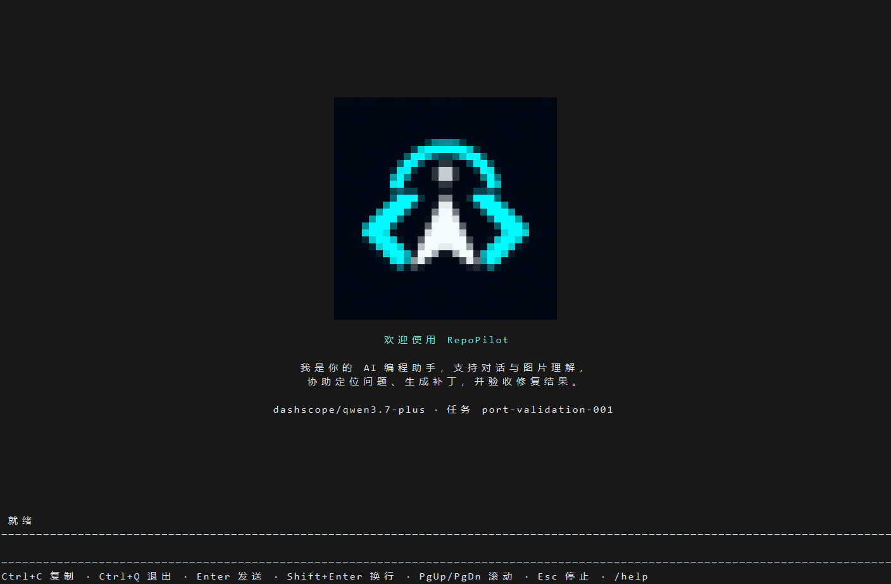
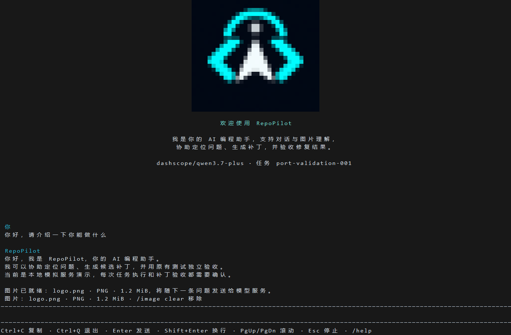
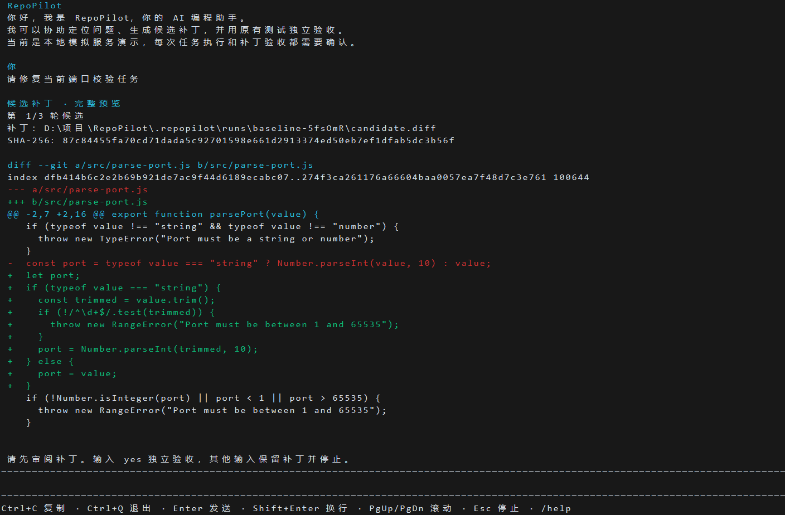
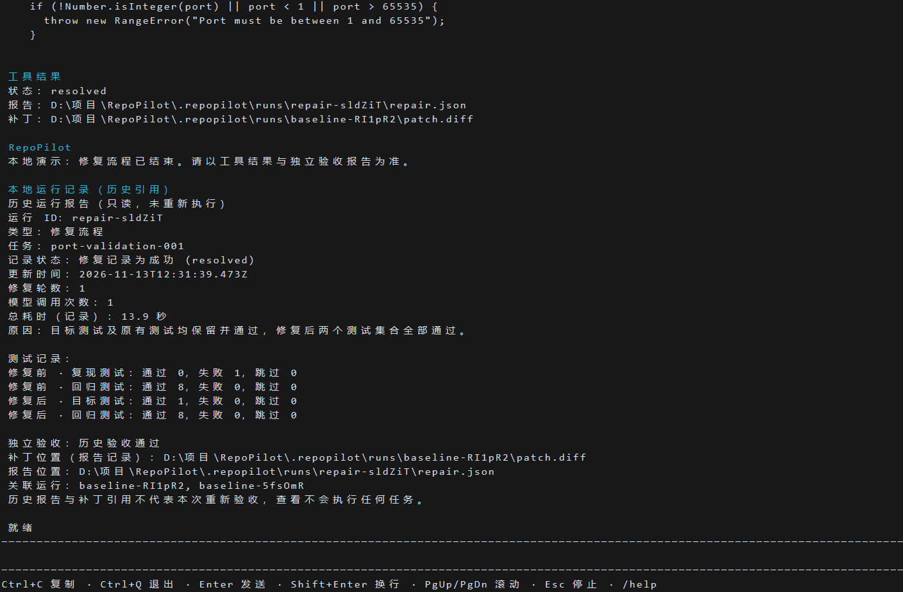

# RepoPilot


RepoPilot 是基于 Pi SDK 和 Qwen 的代码修复 Agent CLI，面向可信的本地 JS/TS 仓库。输入故障提交、复现测试和允许修改的文件，输出可审阅的候选补丁与独立验收报告。

RepoPilot 实现了故障基准复现、授权源码筛选、结构化编辑校验、补丁回放和最多 3 轮的失败反馈。模型生成候选，每轮人工审阅后在新的 Git worktree 重跑测试。独立验收通过后才交付修复补丁。

[MIT License](LICENSE) · [GitHub 仓库](https://github.com/204128-cloud/-) · [来源声明](NOTICE.md)

[无密钥演示与迁移](docs/DEMO.md) · [架构和模块分工](docs/ARCHITECTURE.md) · [简历与面试材料](docs/RESUME.md) · [同预算真实评测](docs/EQUAL_BUDGET.md)

[逐步功能检查](docs/TESTING.md) · [最终功能验收](docs/FINAL_ACCEPTANCE.md)

首次克隆请先按 [发布与迁移说明](docs/PUBLISHING.md) 从 `config/models.example.json` 创建本地配置；真实调用前填写自己的百炼兼容接口地址。无密钥演示使用 `scripts/prepare-extended-cases.mjs` 生成当前机器上的任务。文档后面的旧分页 / Unicode 命令用于已准备历史任务的本机，机器绑定任务与旧 `smoke.json` 不随仓库提交。[来源声明](NOTICE.md)

## 界面展示

以下是当前程序的终端渲染快照。模型服务为本机模拟，补丁审阅、测试与回放执行实际流程；不计入真实百炼评测。[画面来源与复现说明](assets/showcase/README.md)



<details>
<summary>查看图片附件、补丁审阅与验收报告</summary>

聊天与待发送图片：



完整彩色补丁与人工审阅提示：



实际执行目标测试和八项回归后的验收记录：



</details>

## 和 RepoPilot 聊天

在 Windows Terminal 或 VS Code 的 PowerShell 终端启动 Pi 风格界面。出现密钥提示时，复制完整百炼 API Key，回到终端只按回车。

```powershell
cd D:\项目\RepoPilot
powershell.exe -NoProfile -ExecutionPolicy Bypass -File .\Start-RepoPilot.ps1 tui
```

启动后直接进入聊天，输入框上方居中显示放大的 Logo、欢迎语和自我介绍。Logo 使用终端彩色字符绘制，在 Windows 终端也能显示。欢迎内容位于聊天记录开头，会随消息向上滚动；向上翻阅仍可查看，`/reset` 后恢复居中展示。较小窗口自动缩小图标或使用紧凑文字。图片原稿和生成提示词保存在项目中。[Logo 原稿](assets/logo.png) · [生成提示词](assets/logo-prompt.txt)

聊天界面使用 Pi TUI 的滚动记录区和底部多行编辑器。输入问题后按 Enter 提交，Shift+Enter 换行。要让模型看图，先输入 `/image "D:\截图\报错.png"`，再输入「这张截图的报错是什么意思？」。将示例路径换成你的本地文件。每条消息可附加一张 PNG、JPEG 或 WebP，文件上限 5 MiB。提交问题时，图片内容随请求发送给百炼。模型上下文保留最近 8 轮问答及其中最近的一张图片；界面历史与本地会话可以包含更多轮。用 `/reset` 清空当前对话，`/exit` 退出。[百炼图片理解文档](https://help.aliyun.com/zh/model-studio/vision)

Ctrl+J 换行已禁用，多行粘贴仍保留原有换行。更新程序后需退出并重新启动 `tui`。

也可直接输入 `"D:\截图\报错.png"描述一下这张图片`，宿主会读取图片，把图片内容与后面的提问一起发送。只粘贴 `"D:\截图\报错.png"` 则先加入待发送附件，等待下一条问题，不调用模型。直接粘贴只识别消息开头的本地图片路径，含空格时请加引号；提问中提到的路径不会自动读取。`tui` 和逐行 `chat` 都支持。

附图后，输入区上方会显示待发送文件的名称、实际格式和大小；格式由文件签名识别。查看或移除附件不调用模型。

| 图片命令 | 操作 |
|---|---|
| `/image "本地图片路径"` | 为下一条问题附图或替换待发送图片。 |
| `/image` | 查看当前待发送图片的名称、格式与大小。 |
| `/image clear` | 移除待发送图片，继续当前文字对话。 |

发送成功、清空对话或成功恢复会话后，待发送附件会清空；请求失败或按 Esc 中断后会保留，可再次发送。替换图片失败时会清空旧附件，并提示当前没有待发送图片，避免下一条问题误发旧图。`/help`、`/status`、`/doctor`、`/save`、`/sessions`、`/runs` 和 `/report` 保留当前附件。`/image clear` 只影响尚未发送的图片；如需清除已发送图片所在的对话上下文，使用 `/reset`。

回答会逐步显示在同一条消息中。按 Esc 可以停止当前生成、任务执行或待审阅操作，并继续聊天；已显示的半截回答会标为“已中断”，不会加入模型的后续对话上下文。模型请求与任务子进程均接收中断信号，取消后不再开始下一轮模型请求或验收。

模型回复期间可以继续编辑下一条问题，按 Enter 后选择 **排队发送** 或 **引导当前回答**。默认选中排队，使用 ←/→ 或 Tab 切换，Enter 确认；选择框中的 Esc 返回编辑并保留草稿。

- **排队发送**：当前回复成功结束后，按提交顺序自动发送，状态栏显示队列数量；不会同时发起多个聊天请求。
- **引导当前回答**：中断当前请求，等待它结束后，结合原问题、图片和补充要求发起新请求。旧半截回复标记为已中断，不进入后续模型历史；已排队的问题继续等待引导回复结束。

不在选择框时按 Esc 会中断当前操作并暂停队列；请求失败也会暂停队列。`/queue` 查看待发送消息，`/queue resume` 恢复发送，`/queue clear` 清空待发送消息。队列只保存在本次进程中，退出、`/reset` 或成功恢复会话时清空，不写入会话快照。

任务确认或补丁审阅继续使用原来的 yes/no 流程；如果审阅提示到达，消息选择框会关闭，草稿暂存到确认结束后恢复。生成期间输入 `/status`、`/save` 等其他本地命令仍保留为草稿。在 `tui` 中，鼠标选中文字后按 Ctrl+C 复制，Ctrl+Q 或 `/exit` 中断当前操作并退出。上述选择与队列操作用于 `tui`，逐行 `chat` 保持原来的输入和完整回复显示方式。

### 查看当前配置状态

在 `tui` 或逐行 `chat` 输入 `/status`，离线查看本次会话已加载的模型、接口、图片输入配置和绑定任务。接口隐藏用户名、密码、查询参数和片段；疑似凭据及不安全字段不会显示。该命令不调用模型、不验证鉴权、不重新读取配置，也不会改变对话或待发送图片。显示内容不加入模型上下文或本地会话快照。

凭据显示“启动时已加载，未验证鉴权”，只表示聊天启动时已通过本地格式检查。图片能力显示“配置声明支持”或“配置未声明支持”，不代表服务端实测。修改模型配置或密钥后需重启聊天。生成回复期间输入的 `/status` 会保留为草稿，当前操作结束后再按 Enter 查看。

`/status` 只在聊天启动后可用。无法启动时仍可运行 `npm.cmd run dev -- check` 离线检查配置；现有 `auth-check` 会发起联网请求，应按需单独运行。

### 离线诊断配置与任务

在 `tui` 或逐行 `chat` 输入 `/doctor`，逐项检查当前所选模型配置能否加载、是否与本次会话一致，当前进程凭据的格式及其是否与启动时一致，以及绑定任务文件是否变化或无法读取。没有绑定任务时会说明如何绑定，仍可继续普通对话。诊断只输出固定的结果与处理建议，不展示原始配置、密钥或异常详情。

`/status` 查看会话已经加载的状态；`/doctor` 检查当前磁盘配置和进程环境。修改配置后，诊断会提示重启，不会替换正在使用的配置。诊断不会联网，不验证密钥是否有效、地域是否匹配或模型是否可用，也不检查仓库、执行测试或验收补丁。

诊断保留对话和待发送图片，结果不进入模型上下文或已保存会话。TUI 中可按 Esc 中断，检查期间输入的问题保留为草稿；按 Ctrl+Q 退出后不会显示迟到结果。`/doctor` 不需要参数；联网排查使用下面的 `/auth-check`，或独立的顶层 `auth-check` 命令。

### 确认后联网检查鉴权

在 `tui` 或逐行 `chat` 输入 `/auth-check`，界面先展示当前会话的模型、脱敏接口、固定测试内容和可能产生少量费用的提示。每次都须输入 `yes` 才发出一次请求；其他输入取消，TUI 也可按 Esc 取消确认。探针只发送 `Reply OK.`，密钥仅用于请求认证，不发送聊天历史、待发送图片、任务描述或源码。

检查使用本次会话启动时已加载的接口和凭据，不读取后来修改的配置或环境变量。它只做一次直接 HTTP 请求，不通过 SDK 对话流，也不会自动重试或跟随重定向。接口须为不含用户名、密码、查询参数或片段的 HTTP(S) 兼容地址。响应最多读取 64 KiB；即使 HTTP 200，也只有有效的非流式助手回复才会显示请求被接受。该结果不代表图片、流式聊天或修复工具已经验证通过。

| 结果 | 界面建议 |
|---|---|
| HTTP 401 | 核对完整密钥、接口地域和业务空间。 |
| HTTP 403 | 检查账号、业务空间及模型调用权限。 |
| HTTP 404 | 核对兼容接口地址、模型 ID 与授权。 |
| HTTP 429 | 检查调用频率和账户配额。 |
| HTTP 5xx、超时或网络异常 | 按结果提示稍后重试，或检查网络、代理与接口。 |

只显示 HTTP 状态、已知服务错误码和固定建议，不显示原始服务端错误或生成文本。检查期间 TUI 可按 Esc 中断请求，Ctrl+Q 退出；逐行模式按 Ctrl+C 中断并退出。原对话、草稿和待发送图片继续保留，结果不加入模型上下文或会话快照，聊天内检查不另写诊断日志。无法启动聊天时，可继续使用既有的顶层 `auth-check`，其脱敏 JSON 检查记录沿用原保存方式。

### 保存与恢复对话

`tui` 和逐行 `chat` 均支持：

| 对话命令 | 操作 |
|---|---|
| `/save` | 手动保存已完成的问答，返回新的会话 ID。再次保存生成新快照，不覆盖旧会话。 |
| `/sessions` | 查看本地会话 ID、保存时间、轮数和绑定任务编号。 |
| `/resume <会话ID>` | 读取会话，输入 `yes` 后替换当前对话；恢复失败或拒绝确认时保留当前对话。 |

会话以 JSON 保存在 `.repopilot/sessions/`，仅在 `/save` 时写入，退出不会自动保存。只保存完整文字问答、图片省略标记和历史报告引用，不保存图片原始数据、模型请求凭据或可重放的工具参数。中断、失败的半轮和未发送草稿不会保存；恢复后如需识图，请重新使用 `/image` 附图。`/reset` 清空当前对话，不删除已保存快照。

一个会话最多保存 200 轮且整个文件不超过 1 MiB，超出上限会拒绝保存而不截断。恢复可显示全部已保存文字，模型上下文仍遵循最近 8 轮限制。任务会话要求当前绑定任务的编号和文件字节指纹一致，因此应使用原任务 JSON 启动后恢复；恢复不会更改授权文件或执行历史工具，历史报告引用也不代表新的验收结论。

### 查看运行历史与报告

在 `tui` 或逐行 `chat` 中输入 `/runs`，查看 `.repopilot/runs/` 下的本地运行记录，按报告更新时间从新到旧排列。复制列表中的完整运行 ID，输入 `/report <运行ID>` 查看状态、原因、修复轮数、模型调用次数、记录耗时、修复前后测试数量及补丁位置。关联运行 ID 可用同一命令继续查看。

查看记录只读取本地文件，不调用模型、不重跑测试，也不将报告加入模型对话上下文。原对话、草稿和待发送图片会保留。TUI 中可用 PgUp/PgDn 翻阅，Esc 中断读取，Ctrl+Q 退出。

基准就绪、候选生成和评测完成分别保留原状态，不表示修复通过。历史验收通过需要匹配的独立验收记录与测试证据；记录缺失、损坏或证据不一致时会明确提示。报告中的补丁路径只是历史引用，查看不会重新验证补丁。每个报告最多读取 2 MiB，损坏记录计入不可读取数量，同一运行不会回退显示旧阶段的成功状态。

想让它操作已有任务，在启动时绑定任务 JSON。

```powershell
powershell.exe -NoProfile -ExecutionPolicy Bypass -File .\Start-RepoPilot.ps1 tui .\tasks\pagination-empty.json
```

可以问「帮我定位这项任务的问题」或说「请修复这项任务」。模型请求工具时，界面显示操作并等待你确认。修复复用现有流程，每个候选补丁都须审阅后再独立验收。报告和交付补丁的路径会显示在对话记录里。也可以用 `chat` 进入逐行终端模式，图片和任务用法相同。

`tui` 状态栏会显示当前轮次与“复现基准、定位源码、生成候选、等待审阅、独立验收、目标测试、回归测试、补丁回放”等阶段。候选生成后，界面先完整显示对应指纹的 diff，再等待 `yes`；新增行绿色、删除行红色，较长补丁可用 PgUp/PgDn 翻阅。输入其他内容会保留候选并停止，Esc 会中断当前操作并恢复暂存草稿。预览上限为 256 KiB；补丁读取失败、指纹变化或无法安全完整显示时，不会进入确认或执行验收。

### 真实 Qwen 实测

以下是 2026-11-10 的旧 `smoke-v1` 共享首轮实测；2026-11-13 的三个新增构造案例已完成同预算独立对照，结果单独记录。[新增真实结果](docs/EQUAL_BUDGET.md#本机实测)

| 两个固定开发案例 | 验收通过 | 模型调用 | 扣除审阅等待的执行耗时 |
|---|---:|---:|---:|
| 单次候选 | 1/2 | 2 次 | 51.1 秒 |
| 有限反馈 | 2/2 | 3 次 | 94.7 秒 |

两列共享首候选，整次实测共 3 次调用。Unicode 案例的首轮字符类回归失败，第二轮收到测试反馈后通过目标和 6 项回归。两列使用不同调用预算，结果限定于本次两项开发案例。[实测记录](docs/BENCHMARK.md#本机实测)

## 当前可用功能

| 命令 | 作用 |
|---|---|
| `npm.cmd run dev -- check` | 加载项目模型配置，只显示凭据状态，不调用模型。 |
| `npm.cmd run dev -- smoke` | 验证真实文本回复和一次固定文件的只读工具调用，需要环境变量中的密钥。 |
| `npm.cmd run dev -- auth-check` | 直接 HTTP 请求同一接口，输出状态码与已知服务端错误码，用于区分 SDK 与服务端认证问题。 |
| `npm.cmd run dev -- task init [仓库路径]` | 无密钥创建任务，读取已提交脚本与源码，确认后保存 JSON，可选运行基准预检查。 |
| `npm.cmd run dev -- tui [任务文件]` | 在 Pi 风格的终端界面聊天、附加本地图片和审阅修复任务。 |
| `npm.cmd run dev -- chat [任务文件]` | 在交互式终端和 Qwen 连续对话、提交本地图片，也可调用已绑定任务的定位或修复。 |
| `npm.cmd run dev -- baseline <任务文件>` | 不调用模型，在独立 worktree 准备依赖、运行测试并保存基准证据。 |
| `npm.cmd run dev -- locate <任务文件>` | 不调用模型，复现后对授权源码排序，输出预算内的文件选择结果。 |
| `npm.cmd run dev -- propose <任务文件>` | 复现问题并请求 Qwen 提交一次候选编辑，输出可审阅的补丁。 |
| `npm.cmd run dev -- repair <任务文件>` | 最多 3 轮候选，每轮确认审阅后独立验收，符合条件的失败反馈到下一轮。 |
| `npm.cmd run dev -- bench <任务集>` | 在固定任务集比较共享首候选与最多 3 轮反馈结果，生成 JSON/Markdown 对照报告。 |
| `npm.cmd run dev -- bench-equal <任务集>` | 两条独立策略各最多 3 次，比较有反馈与无反馈重试；每轮仍须审阅。 |
| `npm.cmd run dev -- verify <任务文件> <补丁文件>` | 重新建立基准，独立验收候选补丁，输出正式报告和可审查的交付补丁。 |
| `npm.cmd run dev -- --help` | 显示帮助。 |

连接检查与认证检查不等于代码任务修复成功，不产生任务契约中的 resolved 结论。

## 环境与依赖

- 当前验证环境：Windows，Node.js `26.13.0`（记录在 `.node-version`），npm `11.20.0`。
- 最低 Node.js：`22.19.0`；源码直接使用 Node 原生 TypeScript 支持。
- 固定依赖包括 Pi SDK、pi-ai 和 pi-tui `1.5.0`，TypeBox `1.3.27`，Undici `8.12.3`，TypeScript `7.0.2`，Node 类型 `22.19.19`。
- `package-lock.json` 锁定依赖树；`.npmrc` 默认禁用依赖安装脚本。

首次安装或恢复依赖：

```powershell
cd D:\项目\RepoPilot
if (-not (Test-Path -LiteralPath config/models.json)) { Copy-Item -LiteralPath config/models.example.json -Destination config/models.json }
npm.cmd ci --ignore-scripts
npm.cmd run check
npm.cmd test
npm.cmd run build
npm.cmd start -- check
```

开发运行使用 `npm.cmd run dev -- <命令>`，编译后使用 `npm.cmd start -- <命令>`。

## 为自己的仓库创建任务

运行交互向导，不需要 API Key；不提供路径时会询问仓库位置。

```powershell
powershell.exe -NoProfile -ExecutionPolicy Bypass -File D:\项目\RepoPilot\Start-RepoPilot.ps1 task init
```

向导读取仓库当前已提交的 HEAD，忽略未提交修改。按提示填写任务编号、问题描述，从已有 npm scripts 中选择复现和回归脚本，再填写失败测试的完整名称。嵌套测试名称使用 `父名称 > 子名称`；回归集合须排除故意失败的复现用例。最后用编号选择明确允许修改的源码文件，例如 `1,3`。

任务必须仍满足现有支持范围：可信本地 SHA-1 Git 仓库，固定提交中有 `package.json`、`package-lock.json`、两个已有测试脚本，以及 `src/` 下可授权的 JS/TS 常规源码文件。目前测试证据采集要求每个脚本一次 `node --test` 调用。向导不会创建测试或替你猜失败测试名，也不保证任意选中的 npm script 都能通过基准检查。

保存前会展示完整任务与输出路径，只有输入 `yes` 才写入；默认保存在 RepoPilot 的 `tasks/<编号>.json`，已有文件不会被覆盖。随后可单独选择是否运行基准预检查，默认不运行。预检查不调用模型，但会执行 `npm ci` 准备依赖并运行所选测试，因此可能访问包仓库。Ctrl+C 会停止预检查，已保存的任务文件继续保留。

结果中的 `status: created` 只表示任务文件已生成。`precheck.baselineStatus: ready` 才表示缺陷已按约定复现且原回归通过，仍不表示修复成功。创建后可按向导给出的命令运行 `baseline`，或用 `tui <任务文件>` 绑定任务开始修复。

## 运行基准任务

以下分页命令要求本机已有对应历史任务。新安装直接按 [无密钥演示](docs/DEMO.md#推荐三分钟离线演示) 运行自动生成的端口校验任务，或通过任务向导绑定自己的仓库。

```powershell
cd D:\项目\RepoPilot
npm.cmd run dev -- baseline D:\项目\RepoPilot\tasks\pagination-empty.json
```

该命令不需要 API Key。示例仓库位于 `D:\项目\RepoPilot-demo`，真实故障提交为 `4fdfba1abf23e43d3d5b20997b88c7d43790dec4`。目标测试应断言失败，6 项回归应通过；`baselineStatus: ready` 表示基准可用于后续修复，不表示缺陷已修复。

每次运行保留独立的 `.repopilot/runs/baseline-*/baseline.json`、结构化日志和工作副本。原仓库的 HEAD、索引及未提交文件保持原样。当前支持 Windows、带 npm 的 Node 安装、package-lock 和 node:test；[完整命令、状态与支持范围](docs/BASELINE.md)。

Git 按 PATH、Windows 常规安装目录、项目 `.repopilot/tools/git/cmd/git.exe` 的顺序查找，执行时使用绝对路径。当前本机已在项目目录准备官方 MinGit `2.56.0.windows.4` 并核对发布页 SHA-256，不修改系统 PATH；该目录已被 Git 忽略。迁移项目时可安装 [Git for Windows](https://git-scm.com/install/windows)，或重新准备项目本地 MinGit。未找到时明确报告 `GIT_NOT_FOUND`。

## 独立验收候选补丁

```powershell
cd D:\项目\RepoPilot
npm.cmd run dev -- verify tasks/pagination-empty.json patches/pagination-empty.fix.diff
```

该命令不需要 API Key。示例为人工提供的一行修复；已实际验证 `status: resolved`：修改前目标失败、6 项回归通过，修改后目标与回归全部通过，导出的补丁能在第二个干净工作副本中重建实际测试的源码。原演示仓库保持故障版本。

`patches/pagination-empty.wrong.diff` 和 `patches/pagination-empty.test-tamper.diff` 是已验证会被拒绝的反例，预期 `unresolved` / 退出码 1。正式结论保存在本次运行的 `report.json`，不能仅凭 `patch.diff` 存在认定成功。[验收顺序、四种状态、证据格式及支持范围](docs/VERIFY.md)。

## 生成并验收模型候选

```powershell
cd D:\项目\RepoPilot
powershell.exe -NoProfile -ExecutionPolicy Bypass -File .\Start-RepoPilot.ps1 propose tasks/pagination-empty.json
```

看到提示后，复制百炼业务空间的完整 API Key，回到终端只按回车。已有 `DASHSCOPE_API_KEY` 时启动器会直接使用它。任务问题、基准用例摘要和从 `allowedPaths` 中选取的源码会发送给 Qwen。请使用可发送到该服务的任务和源码。

`propose` 先在独立工作副本复现缺陷并选取相关源码。基准与定位有效时发起一次模型请求，接受一批 `submit_edits`，每个文件最多一条编辑。宿主检查编辑只涉及选中文件、原文片段唯一匹配，再将替换结果导出为 `candidate.diff`。该命令执行原基准测试，候选代码只会写到本次工作副本，留给后续验收运行。

`proposed` 表示已生成补丁。在输出的 `artifacts.patch` 找到并审阅它，然后把实际路径作为 `verify` 的第二个参数。只有独立验收的 `resolved` 表示通过修复验收。

```powershell
npm.cmd run dev -- verify tasks/pagination-empty.json '<artifacts.patch 的实际路径>'
```

如果基准目标已通过，`propose` 返回 `not_reproduced`。基准、定位、模型请求、编辑校验或导出失败时返回 `error`。报告路径在 `reportPath`，其中记录候选位置、基准证据、定位报告和修改文件。当前支持 UTF-8 常规文件。启用 Git 自定义过滤器的授权源码会被拒绝，以便在审阅前只生成补丁。JSON 用户上下文上限为 32 KiB，模型响应上限为 2048 tokens，适合范围明确的小修复。

## 定位与上下文选取

```powershell
cd D:\项目\RepoPilot
npm.cmd run dev -- locate tasks/pagination-empty.json
```

该命令不需要密钥，先执行基准，再按问题与失败测试名对 `allowedPaths` 中的源码做词法排序，选择最多 3 个完整文件。最终 JSON 用户消息须在 32 KiB 内，本地扫描上限为 1 MiB。多个文件均无匹配时明确报错，不发起模型请求。`location.json` 记录分数、选择文件和字节数，`propose` 自动复用同一流程，只允许模型编辑选中文件。[选择规则、报告和实测记录](docs/LOCALIZATION.md)。

## 失败反馈与有限重试

```powershell
cd D:\项目\RepoPilot
powershell.exe -NoProfile -ExecutionPolicy Bypass -File .\Start-RepoPilot.ps1 repair tasks/regexp-unicode.json
```

启动器读取本次进程使用的密钥后，程序每轮显示补丁路径和 SHA-256。打开审阅后输入 `yes` 才会独立验收；其他输入或非交互式输入会保留候选并停止。

每次运行最多 3 次模型调用尝试。合法、稳定且实际测试失败的候选，将其完整 diff 和修复后测试摘要反馈给下一次请求；后续仍从原始基准生成，固定首轮源码选择和 32 KiB 用户上下文预算。成功、重复候选、模型错误、越界、完整性或证据错误会停止。汇总报告为 `.repopilot/runs/repair-*/repair.json`，链接各轮实际提议和验收。[完整流程、停止条件和状态](docs/REPAIR.md)。

## 固定任务集与配对评测

以下 `smoke-v1` 文件属于已准备历史任务的本机。新安装运行 `node scripts/prepare-extended-cases.mjs`，再把生成的 `.repopilot/extended-v1/suite.json` 传给 `bench` 或 `bench-equal`；两种报告的预算和计数规则分别记录。

```powershell
cd D:\项目\RepoPilot
powershell.exe -NoProfile -ExecutionPolicy Bypass -File .\Start-RepoPilot.ps1 bench benchmarks/smoke.json
```

默认固定分页与 Unicode 两项任务，先核对任务字节哈希，最多调用模型 6 次，逐轮审阅后验收。报告并列展示共享首轮和完整反馈流程的结果，将审阅等待与执行耗时分开。未审阅、错误和未运行任务单列，不删失败行、不重复计算共享调用。两项开发案例用于冒烟验证，结果不推算总体修复率。[比较设计、任务集、状态与计时](docs/BENCHMARK.md)。

### 新增三个构造基准

第九步已准备端口校验、稳定排序和 Unicode 截断三个构造案例。运行 `node scripts/prepare-extended-cases.mjs` 可校验冻结快照，生成独立仓库及 `.repopilot/extended-v1/suite.json`。基准阶段每项目标断言失败、八项回归通过；后续真实对照仍使用相同的故障提交。[准备方法、契约与基准报告](docs/EXTENDED_CASES.md)

同预算对照使用 `bench-equal`，每策略最多三次。2026-11-13 本机实测两策略均三项首轮修复成功，各三次请求，共六次；六组独立验收和回放全部通过。没有触发失败反馈，因此该次结果不证明反馈策略更好。[计数、真实结果与已验收补丁](docs/EQUAL_BUDGET.md)

## 第二个案例：真实上游缺陷

新增 `escape-string-regexp` 的 Unicode 连字符问题，来源为上游 [issue #20](https://github.com/sindresorhus/escape-string-regexp/issues/20)。`cases/regexp-unicode/` 保存故障源码原始字节、MIT 许可证和适配测试；本机独立仓库已准备在 `.repopilot/cases/regexp-unicode/`。

新机器先按 [换机器复现](docs/DEMO.md#换机器复现) 从公开模板生成任务；下面的旧任务路径仅在已准备该文件的本机可用。

```powershell
cd D:\项目\RepoPilot
npm.cmd run dev -- baseline tasks/regexp-unicode.json
npm.cmd run dev -- verify tasks/regexp-unicode.json patches/regexp-unicode.reference.diff
npm.cmd run dev -- verify tasks/regexp-unicode.json patches/regexp-unicode.model-attempt-1.diff
```

三个命令不需要密钥，预期依次为 `ready`、`resolved`（退出码 0）、`unresolved`（退出码 1）。上游参考补丁通过全部 7 项测试；真实 Qwen 首次候选仍未修复目标，原样保留为失败样本。这是上游缺陷的最小适配案例，测试来自本项目，未运行上游完整测试集。[来源、实际证据与复现步骤](docs/REAL_CASE.md)。

后续第八步已在新的真实 Qwen 运行中通过两轮修复该案例：第一轮回归失败，第二轮根据反馈通过全部 7 项测试。[两轮记录与原样保留的模型补丁](docs/REPAIR.md#真实-qwen-两轮实测)。

## 密钥输入与真实检查

```powershell
powershell.exe -NoProfile -ExecutionPolicy Bypass -File D:\项目\RepoPilot\Start-RepoPilot.ps1
```

默认运行 `smoke`。看到提示后，从百炼北京业务空间复制完整的按量 API Key，回到终端**只按回车**。启动器在确认后从剪贴板读取密钥，并将其暂时传给本次进程。已有 `DASHSCOPE_API_KEY` 时直接使用环境变量，退出后恢复原值。请将密钥留在本机。

模型为 `dashscope/qwen3.7-plus`。在线演示时，将本地 `config/models.json` 的 `baseUrl` 配置为自己的百炼北京业务空间 OpenAI 兼容按量接口。配置只保存环境变量引用，启动器读取本次会话的密钥。[公开配置模板](config/models.example.json)

若 smoke 返回 HTTP 401，使用同一把密钥做独立请求：

```powershell
powershell.exe -NoProfile -ExecutionPolicy Bypass -File D:\项目\RepoPilot\Start-RepoPilot.ps1 auth-check
```

`auth-check` 同样在复制密钥后按回车确认，随后直接向百炼发送一次简短的非流式请求。报告只记录 HTTP 状态与已知服务端错误码。`accepted` 表示收到 2xx 响应，成功的请求会产生少量模型用量。

检查结果保存在已忽略的本地目录：

- `.repopilot/connection-check.json`：SDK 文本及工具检查。
- `.repopilot/authentication-check.json`：独立 HTTP 检查。

## SDK 接入约定

- 显式选择模型、工作目录和 off 思考级别，实际发送 `enable_thinking:false`。
- 凭据、模型缓存与会话使用内存存储；禁用个人插件、Skills、提示模板和上下文文件发现。
- 不主动刷新模型目录；PowerShell 启动器设置 `PI_OFFLINE=1`，该开关不禁止明确发起的推理请求。
- 只读探针仅提供无参数的 read_probe，读取程序生成的公开随机标记文件；未开放任意路径或 shell。
- 检查正常结束、预期标记、全部工具调用次数及成功次数；不能凭模型自述认定读取成功。
- CLI 的 smoke/auth-check 共用 Undici HTTP 实现，读取 HTTP_PROXY、HTTPS_PROXY、NO_PROXY 及对应小写环境变量；退出时关闭连接。
- 请求设有超时，结束后清理订阅、会话和经路径校验的临时目录；日志不包含原始异常、配置或请求头。

## 当前任务摘要

- 当前目标是采用 MIT 许可证，将已验收版本提交到 `204128-cloud/-` 的 main 分支。
- 核心约束为可信本地仓库、固定故障提交、具体源码白名单、实际测试证据和凭据不落盘。Git worktree 隔离文件改动，测试仍使用宿主进程权限。
- 已确认使用 Pi SDK 和 Qwen 生成候选，宿主独立验收。词法定位最多选 3 个完整文件，用户上下文限 32 KiB，每次修复最多尝试 3 轮。
- 现有功能包括 Pi 风格终端聊天、流式回复和取消、多行草稿、本地图片、会话保存恢复、消息排队与引导、任务向导、配置诊断、历史报告、候选审阅与修复验收。TUI 的 Ctrl+C 复制选中文字，Ctrl+Q 或 `/exit` 退出；逐行 `chat` 保持原按键行为。
- 三个构造案例冻结 18 个文件与故障提交，每项目标断言失败、八项回归通过。`bench-equal` 分别运行无反馈和带反馈两臂，各最多三次，整批上限 18 次；旧 `bench` 保留共享首轮设计。
- 真实评测已完成：`bench-ahKZof` 中两策略各三项首轮成功，共六次真实模型请求尝试；六份独立验收、原测试、补丁回放及交付哈希均核对通过。发布版记录与三份模型补丁已保存。[实测记录](docs/EQUAL_BUDGET.md#本机实测)
- 最新验收通过完整 341 项测试、类型检查和构建；干净安装五个阶段、编译版 17 个命令阶段、三个案例的基准/定位/验收和任务向导全部通过。四份修复记录和两份评测匹配独立验收，冻结文件与原仓库保持不变。[最终验收](docs/FINAL_ACCEPTANCE.md)
- 编译版 CLI/TUI 经真实 Pi SDK 连接本机模拟接口，核对 JPEG 字节、引导取消、旧半截历史排除和队列顺序。复制测试使用注入写入器，原生接口可用，未读写系统剪贴板。本轮未调用百炼，没有更改产品源码或测试规则。
- 已知边界：本批六组均首轮成功，没有触发候选失败反馈；三项构造开发案例不能推算总体修复率或反馈收益。上下文限最近八轮与一张图片；手动文字快照最多 200 轮、1 MiB，恢复须匹配任务指纹。当前不支持动态切换模型。
- 发布准备已隔离本机模型配置、机器绑定任务和旧任务集；公开配置和任务模板使用占位符，保留 Pi 与上游来源。已修正指向本机报告的链接；新机器需先从模板创建本地配置。[发布检查](docs/PUBLISHING.md)
- 待发布文件独立迁移已通过七个阶段，完整回归 343 项通过、零失败，离线补丁验收与回放成功。本步未调用百炼；原机器配置保留本地。
- 已补四张终端渲染快照，覆盖欢迎页、聊天与图片附件、补丁审阅、独立验收报告。模型为本机模拟，测试与回放实际执行；画面来源和哈希单独记录。
- 剩余人工确认仍包括真实百炼和实际终端体验，见 [检查指南](docs/TESTING.md)。MIT 许可证和目标仓库已由项目所有者确认；展示材料与发布前检查已完成。

## 项目目标与第一步契约

首版为单用户 CLI，针对一个可信的 TypeScript / Node.js Git 仓库。任务固定基准提交和允许修改的源码文件，输出可审查补丁、实际测试证据与结论；worktree 用于隔离修改，不作为安全沙箱。

修复成功要求：基准版本出现指定测试失败，原回归集合通过；最终补丁非空且范围合法；目标测试和回归集合实际执行并通过；验收依据未被修改。

- [任务输入、输出与四种终态](docs/TASK_CONTRACT.md)
- [独立补丁验收](docs/VERIFY.md)
- [源码定位与上下文选取](docs/LOCALIZATION.md)
- [失败反馈与有限重试](docs/REPAIR.md)
- [固定任务集与配对评测](docs/BENCHMARK.md)
- [真实缺陷案例与实测结果](docs/REAL_CASE.md)
- [输入 JSON Schema](schemas/task.schema.json)
- [分页任务模板](tasks/pagination-empty.template.json)；运行任务由本机准备后使用，模板保留路径与提交占位符。
- [Unicode 正则任务模板](tasks/regexp-unicode.template.json)；[来源与许可证说明](cases/regexp-unicode/UPSTREAM.md)。

Pi 提供模型适配、基础 Agent 循环、工具与会话能力。当前个人增量包括任务契约、基准执行、源码定位与上下文预算、候选编辑约束、受限失败反馈流程、证据采集和独立补丁验收。当前摘要与任务契约作为后续开发依据。

参考：[Pi 源码](https://github.com/earendil-works/pi)、[百炼认证错误说明](https://help.aliyun.com/zh/model-studio/error-code-start)、[接口与地域](https://help.aliyun.com/zh/model-studio/base-url)。
