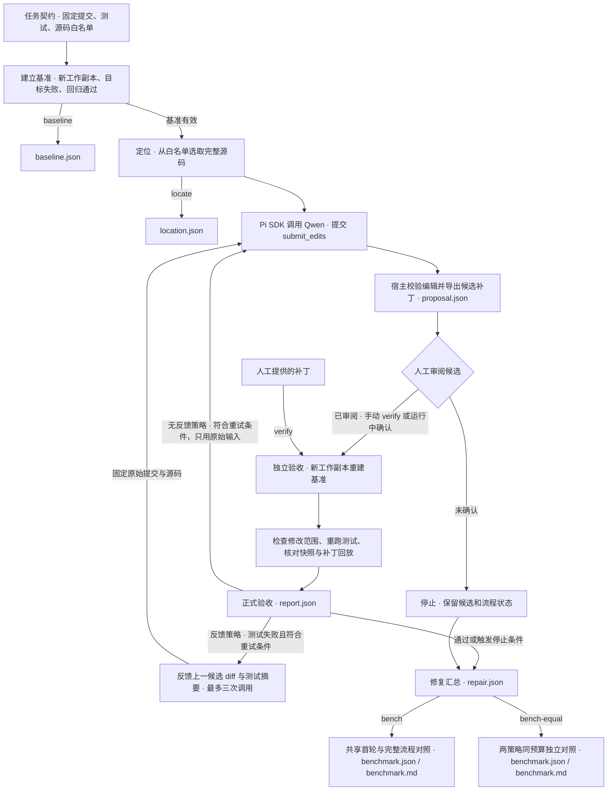

# RepoPilot 架构

RepoPilot 面向可信的本地 JS/TS 仓库。Pi SDK 提供模型调用和结构化工具调用能力，Qwen 通过 `submit_edits` 提交替换建议。RepoPilot 实现任务契约、上下文选取、工作副本管理、证据采集、独立验收、失败反馈和评测。宿主校验并落地编辑，正式结论由验收器根据实际测试证据给出。

## 执行流程

基准未复现或执行失败时，流程在发起模型请求前结束。重试使用同一份原始源码生成候选，每轮仍重新准备工作副本并经过审阅与验收；无反馈策略不加入上一候选和失败摘要，两种策略都最多尝试三次。

终端 `tui` 使用 Pi TUI 的滚动对话区、固定多行编辑器和状态栏。`chat` 提供逐行输入入口。两者共用进程内问答、图片和任务工具，通过同一 Pi 模型运行时发给 Qwen。绑定任务时，模型可以请求 `locate_task` 或 `repair_task`。宿主确认后调用既有流程，回传状态和必要摘要，界面展示实际报告路径。每条问题最多执行一次任务工具。

聊天引擎通过 `streamSimple` 接收文本增量，先校验原文与过滤后的累计文本，再将安全前缀交给界面更新同一个回复组件。可能形成密钥的末尾暂存，工具参数与思考事件不展示。最终消息仍须通过停止原因和工具契约校验后才进入完整会话历史。TUI 的 Esc、退出信号通过每次请求的 AbortController 传到模型调用、任务流水线和子进程；取消后的半轮不进入历史，也不发起工具后的总结请求。

任务入口通过可选回调发送固定阶段与轮次，聊天层转发给 TUI 状态栏，不改变 CLI 的 JSON 输出。TUI 在等待候选确认前有界读取完整补丁，核对原始字节 SHA-256 并检查 UTF-8、控制字符和凭据，再绘制彩色 diff。预览失败会拒绝本轮审阅，正式验收仍重新核对候选指纹。

本地会话使用单独的文字快照：完成的问答保留显示历史，模型请求仍只取最近八轮。`snapshot()` 复制文字、图片省略标记、报告引用与任务指纹；`restore()` 校验格式、任务一致性和取消信号后才替换历史，不恢复图片或工具调用。存储层只接受固定字段，UUID 文件独占创建，限制轮数与文件大小，加载时重新校验 UTF-8、控制字符和凭据。两个聊天入口提供手动保存、列表及确认后恢复的命令。

待发送图片由 `ChatAttachment` 维护安全文件名、实际读取字节数及 `ImageContent`。TUI 附件条与逐行模式共用格式化和命令解析；模型调用只接收内部 `image`，不混入显示元数据。查看和移除是本地操作，更换失败清除旧附件；加载后的提交核对当前请求与取消状态，防止迟到结果重新挂图。会话快照继续省略图片原始数据。

运行历史由 `/runs` 和 `/report <运行ID>` 在聊天入口本地处理，不经过模型或任务执行器。读取层只接受生成规则内的运行 ID，有界读取常规 JSON 文件，并投影状态、测试数量和产物引用。同一运行优先显示更后阶段的报告；该报告损坏时不回退到旧阶段。修复汇总只在任务、提交和候选指纹等信息匹配时引用独立验收证据。输出明确标为历史记录，取消或退出后不再显示迟到结果，也不改变模型对话与待发送图片。

`/status` 同样由两个聊天入口本地处理，使用 `chat.status()` 同步投影当前已加载模型和任务。投影先剥离接口认证信息、参数和片段，再过滤凭据与控制字符，随后交给共享显示函数；不把原始模型配置或密钥交给界面。该操作不重载配置、不发起鉴权探针，也不读取或改变会话历史，凭据状态与图片能力均明确标为本地加载状态或配置声明。

`/doctor` 使用 `chat.doctor(signal)` 离线创建独立的临时模型运行时，读取当前配置并比较所选模型；凭据沿用已有格式检查，任务沿用启动字节一致性检查。不会更新正在使用的运行时、读取模型会话历史或执行任务。诊断只返回固定消息和四种状态（通过、提醒、需处理、说明），共享格式化模块负责显示。外部取消信号传入运行时加载，TUI 和逐行模式在操作取消或退出后抑制迟到结果。

`/auth-check` 在两个聊天入口逐次展示请求内容并确认，再调用 `chat.authCheck(signal)`。它把已经加载的模型和凭据传给共享的 `requestAuthentication`，避免确认后重读配置造成目标变化。独立 CLI 的 `checkAuthentication` 复用同一传输。传输只发固定文本，禁用重定向，限制响应读取到 64 KiB，将外部取消与 30 秒超时传入 HTTP 请求；只有有效的非流式助手回复可使 2xx 结果成为 accepted。响应只投影 HTTP 状态和已知错误码，原始服务文本与生成内容不返回界面；聊天内结果不进入模型上下文、快照或独立日志。

## 模块分工

`bench-equal` 在同一任务上分别调用修复器的 `no_feedback` 与默认 `feedback` 策略。两臂独立生成、审阅和验收，各受相同三次上限及安全停止规则约束；按任务交替执行顺序。比较器核对完整原始上下文哈希和固定输入，单独统计请求回调尝试数，并保留未运行、待审阅及错误项。旧共享首轮评测继续由原模块实现。

| 层 | 职责 | 源码 |
| --- | --- | --- |
| 同预算对照 | 比较独立的反馈与无反馈修复，检查固定输入和原始上下文，统计两臂实际尝试与耗时。 | [独立比较器](../src/equal-benchmark.ts)、[修复策略](../src/repair.ts) |
| CLI 与任务契约 | 分派任务命令，处理终端交互与审阅，校验任务字段、路径格式和提交格式。 | [CLI](../src/cli.ts)、[任务加载](../src/task.ts)、[任务 Schema](../schemas/task.schema.json) |
| 任务创建向导 | 从固定 HEAD 读取脚本与常规源码，确认具体授权与失败测试名，独占创建合法任务 JSON，可选运行基准检查。 | [仓库扫描与保存](../src/task-init.ts)、[交互向导](../src/task-wizard.ts) |
| 多轮聊天与图片 | 使用 Pi TUI 渲染界面，保留进程内会话，附加本地图片，校验并确认模型提出的任务操作。 | [终端界面](../src/chat-tui.ts)、[聊天与工具](../src/chat.ts)、[图片读取](../src/chat-image.ts) |
| 本地会话存储 | 手动保存完整文字快照，列出会话元数据，有界读取并校验会话，恢复时保留任务授权边界。 | [会话存储](../src/session-store.ts) |
| 运行历史与报告 | 只读列出本地运行，汇总测试与产物引用，核对关联的独立验收记录，共享终端显示。 | [报告读取](../src/run-history.ts)、[报告显示](../src/run-display.ts) |
| 当前会话状态 | 从当前运行时投影安全配置，离线显示模型、接口、图片输入声明和绑定任务。 | [状态投影与显示](../src/chat-status.ts) |
| 离线诊断 | 比较当前模型配置、进程凭据与启动状态，核对任务文件一致性，只返回固定诊断消息。 | [检查实现](../src/chat.ts)、[诊断显示](../src/chat-doctor.ts) |
| 联网鉴权检查 | 逐次确认后发送固定探针，复用共享 HTTP 传输，支持中断、超时与脱敏结果建议。 | [共享传输](../src/pi.ts)、[确认与结果显示](../src/chat-doctor.ts) |
| 基准与测试证据 | 从固定提交创建 detached worktree，按锁文件安装依赖，采集并校验目标断言和回归证据。 | [基准执行](../src/baseline.ts)、[进程执行](../src/process.ts)、[测试 reporter](../src/test-reporter.ts)、[证据解析与判定](../src/evidence.ts) |
| 定位与上下文 | 结合问题描述和失败测试名对授权源码做词法排序，记录选择及字节预算。 | [源码定位](../src/localization.ts) |
| 模型与候选 | 通过 Pi SDK 的 `ModelRuntime.completeSimple` 请求一个工具调用。宿主验证选中文件、编辑格式和原文唯一匹配，再写入本次工作副本并导出 `candidate.diff`。 | [Pi 适配](../src/pi.ts)、[结构化编辑](../src/repair-edits.ts)、[候选生成](../src/proposal.ts) |
| 独立验收与完整性 | 从原任务重建基准，检查补丁范围、测试证据与前后快照，在第二个干净 worktree 回放导出的补丁。 | [验收器](../src/verifier.ts)、[快照与范围检查](../src/integrity.ts) |
| 审阅、反馈与评测 | 记录审阅与补丁哈希，按验收证据决定是否重试，按固定任务集汇总结果、模型调用数和耗时。 | [修复编排](../src/repair.ts)、[评测](../src/benchmark.ts)、[构造案例清单](../benchmarks/extended-v1.cases.json) |

## 设计取舍与适用范围

- **先限定候选范围。** `allowedPaths` 明确可改的具体文件。定位最多选取三个完整 UTF-8 源码文件，最终 JSON 用户消息上限为 32 KiB。模型每个选中文件最多提交一条片段替换。这适合范围明确的小修复，依赖更多文件的任务可能超出预算。[定位规则](LOCALIZATION.md)
- **把补丁与测试证据绑定。** 通过审阅的候选按哈希核对。验收在独立工作副本中使用原任务授权，要求原有测试身份保留、目标与回归全部通过、候选快照稳定，以及导出补丁能重建实际测试的授权源码。重复建立基准、扫描快照和回放补丁增加执行开销。[验收规则](VERIFY.md)
- **只用可核对的失败反馈。** 符合条件的测试失败才进入下一轮，反馈包含上一候选完整 diff 和白名单内的测试摘要。重复补丁、上下文超限或证据异常会停止，单次 `repair` 最多尝试调用模型三次。[重试规则](REPAIR.md)
- **运行环境固定。** 当前支持可信本地 SHA-1 Git 仓库、Windows、随 Node 安装的 npm、已提交的 `package-lock.json`，以及每个测试脚本一次 `node --test` 调用。worktree 隔离文件改动，测试仍在宿主进程权限下执行。模型请求会把问题、测试摘要、选中源码及适用的反馈发给 Qwen。[任务契约](TASK_CONTRACT.md) · [基准支持范围](BASELINE.md)

## 评测边界

`bench` 使用空数组分页和公开历史 Unicode 缺陷做共享首轮冒烟评测，单轮与反馈流程的预算不同。`bench-equal` 为新增三个构造案例运行同预算、独立采样的两条策略。2026-11-13 的六组真实运行全部首轮通过，没有触发失败反馈；它验证了这批案例上的独立生成与验收流程，不能说明反馈效果。两批都是开发案例，结果不合并推算总体修复率。[旧共享首轮评测](BENCHMARK.md) · [同预算设计与实测](EQUAL_BUDGET.md) · [上游案例适配范围](REAL_CASE.md)
