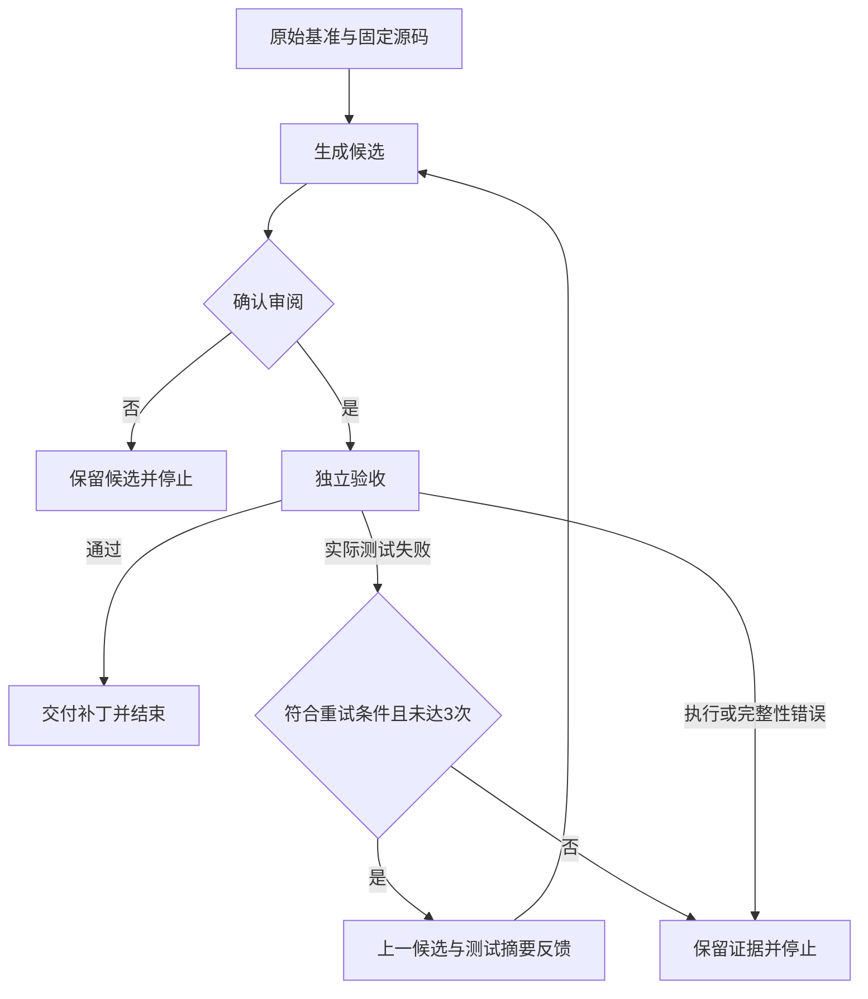

# 第八步：失败反馈与有限重试

本文运行 ID 对应本机历史记录，完整 `.repopilot/runs/` 报告未随仓库分发；公开案例、补丁及新增三案例的结果快照另行保留。

`repair <task.json>` 将已有定位、候选生成和独立验收串成单进程流程。一次运行最多调用模型 3 次，每个新候选都保留人工审阅；任务八字段、原始故障提交与验收标准不变。

## 运行

```powershell
cd D:\项目\RepoPilot
powershell.exe -NoProfile -ExecutionPolicy Bypass -File D:\项目\RepoPilot\Start-RepoPilot.ps1 repair D:\项目\RepoPilot\tasks\regexp-unicode.json
```

看到密钥提示后，复制所属百炼业务空间的完整 API Key，回到终端只按回车。密钥只用于本次进程，依赖安装与测试子进程沿用环境白名单。

每轮会显示候选补丁的完整路径与 SHA-256。先打开补丁审阅，确认后输入 `yes`；程序随后重新建立故障基准，并在新的独立 worktree 中验收。其他输入、EOF 或非交互式输入会停止，保留候选与 `awaiting_review` 报告。

测试未通过且满足继续条件时，程序生成下一候选，再次停在审阅提示。通过验收后立即结束，交付补丁指向实际验收导出的文件。原仓库保持故障版本，可重复执行。



## 固定预算与停止条件

- 一次运行最多 3 次模型调用尝试，包含首轮；SDK 自身仍不自动重试。成功会提前停止。
- 每次模型调用最长 60 秒、响应最多 2048 tokens；子命令超时沿用执行器的 120 秒。人工审阅时间单独等待。
- 首轮选中的文件集合与源码原文固定，任务字节必须保持不变。后续每轮从原始 `baseCommit` 创建新工作副本，编辑仍针对原始源码，不能基于上轮修改后的工作副本继续叠加。
- 完整 JSON 用户消息仍受 32 KiB 限制，包含本轮反馈；原有最多 3 个完整文件、1 MiB 本地扫描限制不变。反馈放不下时明确报 `CONTEXT_TOO_LARGE`，不截断源码或切换文件集合。
- 只有新的真实验收报告为 `unresolved`、没有错误码、快照稳定、补丁回放一致、两个修复后测试阶段均有非跳过证据且退出码一致、至少存在一个实际失败时，才会继续反馈。
- `resolved`、`not_reproduced`、基础设施错误、越界、完整性错误、证据解析错误或跳过测试均停止。候选补丁 SHA-256 与此前候选完全相同时，以 `DUPLICATE_CANDIDATE` 停止，不重复执行同一补丁。
- 三次候选经验收后仍失败时，以 `ATTEMPT_LIMIT` / `unresolved` 结束。

这里限制的是单次命令运行。重新执行 `repair` 会创建新的运行；本阶段不提供会话恢复或全局调用配额。

## 失败反馈内容

下一次请求仍包含原始问题、基准测试摘要和首轮选中的完整源码，并加入：

```text
feedback.previousCandidate    上一候选的完整 diff
feedback.checks               after-reproduce / after-regression
  phase / exitCode            实际测试阶段与退出码
  tests                       file / fullName / status / assertionFailure
```

反馈不包含原始 stdout、stderr、异常、堆栈、断言实际值或服务端原始错误。宿主不会把旧 JSON 报告作为修复成功依据：每轮都实际调用独立验收器。修复成功仍要求原测试身份保留并全部通过，详细规则见 [VERIFY.md](VERIFY.md)。

候选的哈希在审阅前记录，确认后、验收后再次核对，并与验收器实际读取的输入哈希比较。交付补丁还需与验收报告中的哈希一致。

## 运行报告

汇总保存在本次 `.repopilot/runs/repair-*/repair.json`。每轮的 `proposal.json`、`location.json` 和独立 `report.json` 仍位于各自的 `baseline-*` 目录，通过汇总引用关联。

| 字段 | 内容 |
|---|---|
| `kind` | `repair_run`，表示交互修复流程汇总。 |
| `taskHash` / `sourceFingerprint` | 固定任务字节与所选原始上下文的指纹，不保存原文。 |
| `maxAttempts` / `modelRequests` | 固定上限 3，以及已调用模型回调的尝试次数；SDK 在真正发 HTTP 前失败也会计一次。 |
| `selectedPaths` | 本次固定的源码选择。 |
| `attempts` | 每轮提议、候选位置与哈希、上下文字节、是否包含反馈、是否确认审阅、实际验收报告位置。 |
| `artifacts.patch` | 只有成功验收时引用实际交付补丁，其余为 null。 |
| `artifacts.verification` | 最近一次实际验收报告，尚未验收时为 null。 |

| 汇总状态 | 含义 | CLI 退出码 |
|---|---|---|
| `resolved` | 新生成的候选通过独立验收。 | 0 |
| `unresolved` | 候选未修复、达到上限或重复提交，已停止。 | 1 |
| `not_reproduced` | 没有复现指定目标缺陷，停止请求。 | 1 |
| `awaiting_review` | 候选已保留，本次未确认执行。 | 1 |
| `error` | 输入、模型、上下文、完整性或执行错误。 | 2 |

`awaiting_review` 是流程状态，不是正式验收结论。停止后可审阅已保留的补丁，再单独调用 `verify <task.json> <候选补丁>`。新的 `repair` 命令从首轮开始。

第九步为新运行增加了逐轮状态、调用次数、累计耗时与审阅等待计时，配对评测从同一次流程提取首轮和最终结果。旧报告不补造这些字段，计时口径见 [BENCHMARK.md](BENCHMARK.md)。

## 真实 Qwen 两轮实测

2026-11-10，用户在本机运行 Unicode 连字符案例，并逐轮确认已审阅。使用既有 `dashscope/qwen3.7-plus` 配置；共 2 次模型调用尝试，第二轮通过后结束。

| 轮次 | 实际修改 | 用户消息字节 | 修复后目标 / 回归 | 独立验收 |
|---|---|---|---|---|
| 1 | 删除连字符转义 | 1697 | 目标通过 / 5 通过、1 失败 | `unresolved` |
| 2 | 连字符使用 `\\x2d`，其他元字符继续转义 | 3226，含上一候选和真实失败反馈 | 目标通过 / 6 全通过 | `resolved` |

第一轮失败的是 `hyphens remain literal inside a non-Unicode character class`。第二轮仍以原始故障源码为基准，未修改测试或扩大授权。最终快照稳定、补丁回放一致，任务、审阅候选与交付补丁哈希均已核对，原始故障仓库保持干净。

- 两轮修复汇总（`repair-vsRgem/repair.json`）。
- 首轮独立失败报告（`baseline-wtxN0c/report.json`）。
- 第二轮独立通过报告（`baseline-xCsUu8/report.json`）。
- [原样保留的模型交付补丁](../patches/regexp-unicode.model-repair.diff)，SHA-256：`0a9e745431b0135a6145553b63b458dad52d29e518a516ae0b37273598779af6`。

报告位于本机忽略目录，模型补丁可随项目保留。下列命令无需密钥，可重新独立验收相同补丁：

```powershell
cd D:\项目\RepoPilot
npm.cmd run dev -- verify tasks/regexp-unicode.json patches/regexp-unicode.model-repair.diff
```

此处记录一次实际运行，不推算模型总体修复率；案例出处和最小适配范围见 [REAL_CASE.md](REAL_CASE.md)。

## 自动化验证

测试使用本地确定性模型回调与私有 Git fixture，真实执行 npm 基准、补丁应用、测试和补丁回放，不产生 Qwen 用量。覆盖错误候选后修复成功、三次上限、重复候选提前停止、拒绝审阅不执行、非法编辑停止，以及反馈字段白名单和精确 32 KiB 边界。这些结果用于验证流程，不计作真实模型修复率。

本步完整自动化回归为 129 项，全部通过，0 失败、取消或跳过；类型检查、构建和编译后命令帮助检查通过。5 项多轮集成测试和 6 项反馈专项均包含在该回归集合中。

```powershell
node --test test/repair-feedback.test.ts test/repair.test.ts test/cli.test.ts test/launcher.test.ts
npm.cmd run check
npm.cmd run build
```
